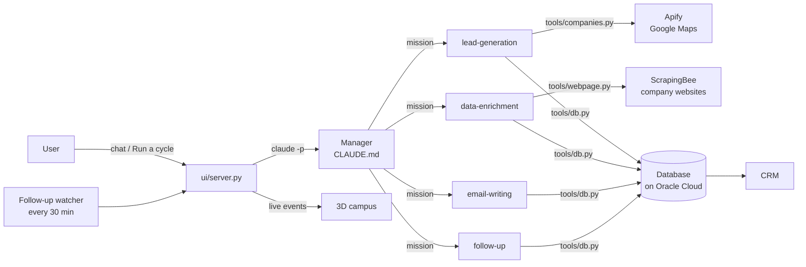

# NovaCorp — Autonomous B2B prospecting agents

A team of AI agents, built on **Claude Code subagents**, that finds companies matching an ideal customer profile, enriches them with sourced data, writes personalised first emails and prepares follow-ups. A built-in **CRM** shows every prospect, and a **3D campus** shows the agents working live.

Each user connects **their own accounts** (Anthropic, Apify, ScrapingBee) from the CRM's **Settings** page: no key ever lives in the code.

## What it does

1. **Finds companies** in any country and any industry with **Apify** (Google Maps scraper): name, category, address, phone, website, Google rating and reviews.
2. **Enriches them** by reading their websites with **ScrapingBee** (handles JavaScript sites and anti-bot protection). It finds the right decision-maker, a **published** business email (never guessed), public profiles, a recent verifiable "hook" and a short company debrief, each with its source.
3. **Writes the first email.** Each email is short and personalised around the hook, with one clear ask and an unsubscribe line. Emails are saved as drafts.
4. **Follows up.** When an email has had no reply for 2 days, the server automatically starts a cycle and the follow-up agent prepares the next message (2 follow-ups at most).
5. **Learns.** After each cycle the Manager records which segments, sources and hooks work.

**A human stays in control:** the agents never send an email. The user reviews the drafts in the CRM, sends them, and marks them "sent" or "replied".

## The platform

- **CRM (home page)**, with three views:
  - **Contacts**: every prospect, the date it was found, its stage, and the date the email was sent;
  - **Pipeline**: a board from "new" to "replied";
  - **Prospect record**: contact details, public profiles, company, debrief, enrichment, emails and follow-ups with their dates, and the agents' history.
- **Settings → Integrations**:
  - the user pastes their own Anthropic, Apify and ScrapingBee keys and checks each one with a **Test** button;
  - keys are stored only on the server, readable by its owner only, and are never sent back in full (`sk-ant…a3F9`);
  - without an Anthropic key, the agents use the Claude account logged in on the server.
- **Agents campus**: a 3D view of the team, with the chat to the Manager and everything the agents do, live.

## Architecture



- **The Manager** is the main Claude Code session. It reads the target, takes stock, decides what is most useful, writes a precise mission for one specialist, checks the result against quality rules, and updates the strategy.
- **The subagents** are each a full Claude instance with their own instructions (`.claude/agents/*.md`), a fresh context and **only the tools their job needs**. For example, the email writer has no web access. They never talk to each other: everything goes through the Manager and the database.
- **The database layer** (`tools/db.py`) is the only way to write data. It enforces the hard rules in code rather than in prompts:
  - no duplicate company (same website, same Google Maps place, or same name in the same city);
  - no duplicate email;
  - a daily draft limit and a follow-up cap;
  - permanent unsubscribes.
- **The server** (`ui/server.py`, Python standard library only) runs Claude Code headless, turns its `stream-json` output into readable events, and serves the CRM and the campus.
- **Keys:** `tools/env.py` reads the keys saved from the Settings page (or set in the environment) and hands them to the tools and to Claude Code at run time. The code only knows their names.
- **Hosting:** the platform and its data run on an **Oracle Cloud** server. Prospect data never leaves it.

## Guardrails

| Risk | How it is handled |
|---|---|
| Invented data | Every contact field needs a source URL; the Manager rejects unsourced work |
| Guessed emails | Forbidden in the instructions; no email means no draft |
| Spamming | No automatic sending; daily draft limit and follow-up cap enforced by the database |
| Unsubscribes | Permanent blocklist checked on every insert |
| Agents doing damage | Edits to the tools, the agent definitions and the database file are blocked, as are `sqlite3`, `rm -rf` and `git push` |
| GDPR | Public professional data only; LinkedIn is never scraped (the tools refuse it, URLs only) |
| Secrets | Each user's API keys are entered in Settings, stored on the server only (owner-readable file), shown masked, never in the code |
| Exposed server | Local-only by default; refuses to open to the network without a password (HTTP Basic auth) |
| Malicious websites (CSRF) | The server only accepts JSON requests coming from its own pages |

## Run it

Requirements: Python 3.9+ and [Claude Code](https://claude.com/claude-code). You also need your own accounts: Anthropic (or a logged-in Claude account), Apify and ScrapingBee.

1. Start the server:
   ```bash
   python3 ui/server.py    # CRM on http://127.0.0.1:8770, agents campus on /campus
   ```
2. Open **Settings** in the CRM, paste your keys (`ANTHROPIC_API_KEY`, `APIFY_TOKEN`, `SCRAPINGBEE_API_KEY`) and click **Test**. They can also be set as environment variables on the server.
3. In Claude Code, in the same folder, run `/target` to describe your offer and ideal customer.
4. Run cycles from the campus (Manager → Run a cycle) or with `/cycle`, and use `/report` for a status update.

Optional server settings: `HOST`, `PORT`, `PASSWORD` (required as soon as the server is reachable from the network) and `AUTO_FOLLOWUP=0` (turns off the automatic follow-ups).

## Project structure

```
CLAUDE.md                  Manager instructions (strategy, cycle, quality rules, guardrails)
.claude/agents/            The 4 subagents
.claude/commands/          /target, /cycle, /report
.claude/settings.json      What the agents are allowed to run
config/target.template.md  Offer, ideal customer, limits; /target turns it into config/target.md
tools/db.py                Database CLI: the only write path, enforces the rules
tools/companies.py         Company search with Apify (Google Maps)
tools/webpage.py           Website reading with ScrapingBee (text, published emails, social links)
tools/env.py               Stores and reads each user's API keys (never in the code)
ui/server.py               Server: runs the agents, live events, CRM API, follow-up watcher
ui/crm.html, crm.js, crm.css         CRM (contacts, pipeline, prospect record, settings)
ui/campus.html, campus.js, campus.css  3D campus (Three.js) with the Manager chat and live activity
```

## Tech

Claude Code (headless, subagents, slash commands), Apify, ScrapingBee, Python standard library (`http.server`, `sqlite3`), vanilla JavaScript, Three.js, Oracle Cloud.
